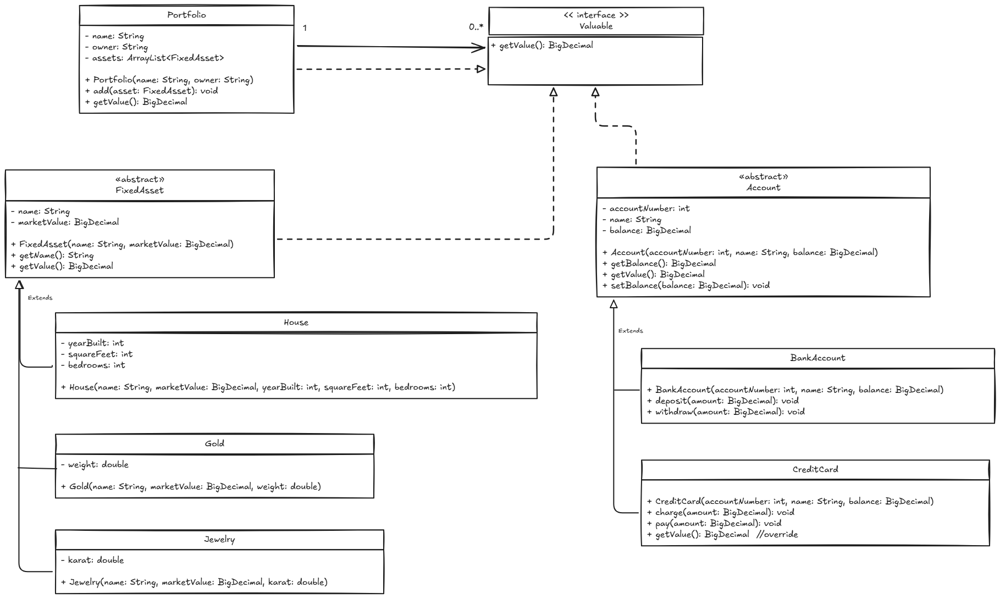

### Did the deposit work for both accounts? Why or why not?

- account2 failed fails: it has no deposit() because Valuable doesn't list one, also failed due to the 100 is a int instead of a BigDecimal

### What methods are available for account1?

-add deposit() and withdraw(), since it's declared on BankAccount and inherited from Account.

### What methods are available for account2?

- Only getValue(), that is defined in Valuable 

### Why?

- account 1 is declared as BankAccount and account2 is declared as Valuable, even though both are BankAccount objects. it uses the variables reference type when it compiles.

### Why Portfolio implements Valuable?

-Portfolio implements Valuable because it has a value (getValue()) like assets and accounts, letting a portfolio hold nested portfolios alongside other valuables.

## Screenshot

